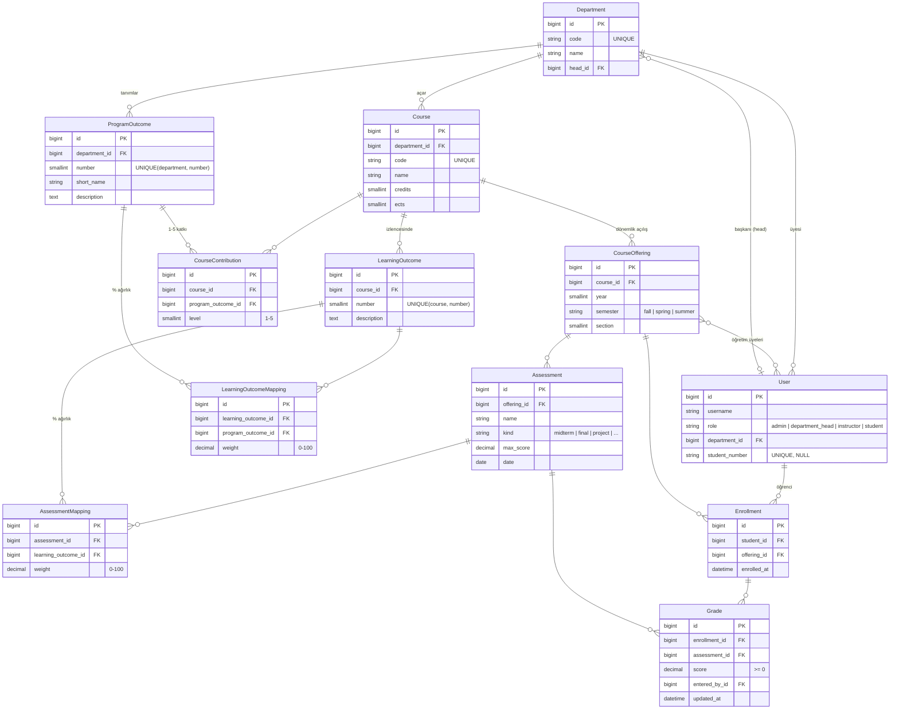

# Veri Modeli

Puanlar üç adımda akar: **Not → Öğrenme Çıktısı (LO) → Program Çıktısı (PO)**.
Her adımda formül aynıdır: `puan = Σ(ağırlık × puan) ÷ Σ ağırlıklar`.

## ER diyagramı

## Tasarım kararları

| Karar | Neden |
|---|---|
| **LO'lar `Course`'a, değerlendirmeler `CourseOffering`'e bağlı** | Öğrenme çıktıları izlencede tanımlanır ve dönemden döneme pek değişmez. Sınavlar ve notlar ise her dönem farklıdır. |
| **İki ayrı ağırlık türü** | `LearningOutcomeMapping.weight` (%) LO'ların ders içinde PO'ya nasıl aktığını belirler. `CourseContribution.level` (1–5) ise derslerin öğrencinin genel PO profilinde ne kadar sayılacağını belirler. |
| **Notlar 0–100'e normalize edilir** | 20 puanlık bir quiz ile 100 puanlık bir sınav aynı formülde birleştirilebilsin diye. |
| **Girilmemiş not 0 sayılmaz** | Henüz notu girilmemiş değerlendirmeler hesaba katılmaz. Böylece dönem ortasında puanlar haksız yere düşmez. |
| **Kısıtlar veritabanında** | `UNIQUE` ve `CHECK` kısıtları (ağırlık 0–100, katkı 1–5, not ≥ 0) uygulama hatası olsa bile veriyi tutarlı tutar. |
| **Puanlar saklanmıyor, hesaplanıyor** | Şimdilik puanlar her istekte hesaplanıyor (`grading/scoring.py`). Veri büyüyünce önbellek veya materialized view eklenebilir. |

## Diyagram dosyaları

| Diyagram | Kaynak (Mermaid) | Görsel |
|---|---|---|
| Sistem mimarisi | [diagrams/architecture.mmd](diagrams/architecture.mmd) | [img/architecture.svg](img/architecture.svg) |
| Sınıf diyagramı | [diagrams/class-diagram.mmd](diagrams/class-diagram.mmd) | [img/class-diagram.svg](img/class-diagram.svg) |
| ER diyagramı | [diagrams/data-model.mmd](diagrams/data-model.mmd) | [img/data-model.svg](img/data-model.svg) |

Mimari diyagramında kesik çerçeveli kutular planlanan, düz çerçeveliler bugün kodda olan bileşenlerdir.
